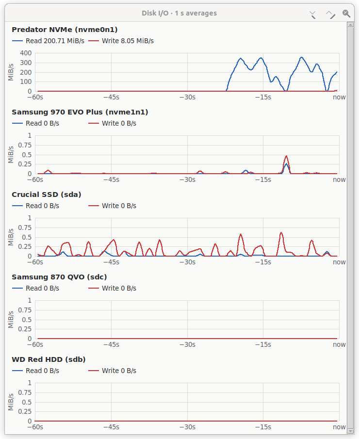

# Disk I/O viewer

A local Linux desktop monitor for per-drive read and write throughput.

## Standalone Linux executable

Run `just build` from the project directory using uv and a Python 3.12+ installation with Tk support. Launch the resulting `dist/disk-io-viewer` directly in your graphical session. You can move the executable and its adjacent `disk-io.toml` together to another directory on this machine. The executable includes Python and Tk.

The first build copies your local device list into `dist/disk-io.toml`, using the example if you have no local configuration yet. Edit that copy and restart the viewer to change the monitored drives. Rebuilding preserves your edits. Use `--config PATH` to select another file.

## Running from source

Run `just run` from the project directory.

On a new checkout, copy `disk-io.example.toml` to `disk-io.toml` and edit the device paths and labels. Use `lsblk -d -o NAME,MODEL,SIZE,ROTA` to identify drives and `ls -l /dev/disk/by-id` to find stable links. Each entry gets a panel in file order. Restart after editing. To use another file, run `just run /path/to/config.toml` or `uv run --locked python -m disk_io_viewer --config /path/to/config.toml`.

The solid blue curve shows reads and the solid red curve shows writes. The graph scrolls between samples, and each curve passes through the measured rates. Each value averages all bytes transferred by the device between consecutive samples, including bursts that finish between updates. The defaults are a one-second sampling interval and one minute of history. Each panel scales to its own peak over the visible window. Gaps indicate unavailable measurements.

Click a drive graph to open its SMART report in a separate window. Refresh reads a new report. This uses the host's `smartctl` from smartmontools for both SATA and NVMe drives. At startup, authenticate once in the desktop polkit prompt to allow read-only SMART queries for the configured drives. All report windows and refreshes share this access until the viewer exits. Canceling the prompt keeps throughput monitoring and any SMART reads permitted by your normal account available. Restart to request access again.

Run `just check` for Ruff and `just test` for tests. To exercise Tk tests on a headless Linux host, use `xvfb-run -a just test`. See the [architecture](docs/architecture/disk-io-viewer.md) for counter semantics and configuration details.
